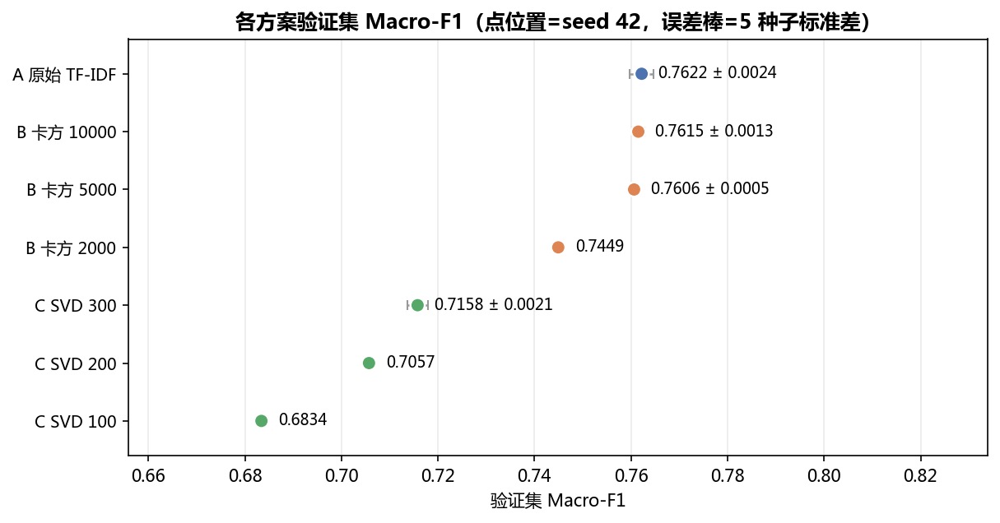
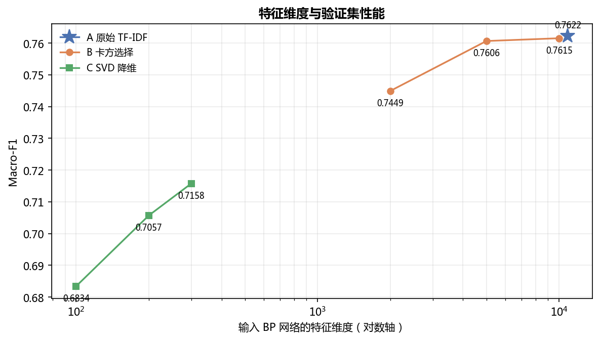
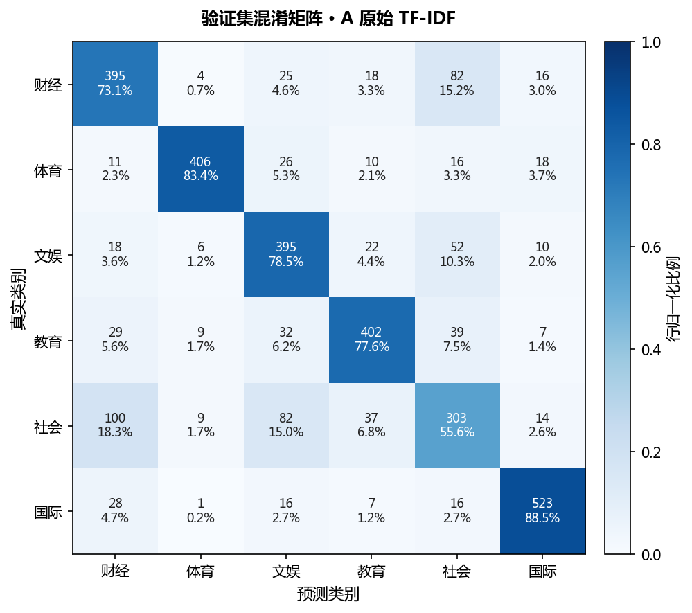

# 第一轮 BP 神经网络实验结果报告

> 本报告由 `report_experiments.py` 从 `results/` 下的实际运行产物自动生成，
> 表格、图与引用的数字全部来自真实执行结果，未做人工填写或预设。
> 生成时间：2026-11-04 17:55:50 ｜ 运行记录总数：23 ｜ 数据版本 `1.1.0`

## 1. 实验环境与数据

| 项目 | 值 |
|---|---|
| 数据集版本 | `1.1.0`（划分版本 `1.0.0`） |
| 训练集 | 6,549 条（2025-01-01 ~ 2025-12-31） |
| 验证集 | 3,184 条（2026-01-01 ~ 2026-06-30） |
| 测试集 | 2,267 条（2026-07-01 ~ 2026-10-31） |
| 类别数 | 6（财经 / 体育 / 文娱 / 教育 / 社会 / 国际） |
| 框架 | PyTorch（CPU，无 GPU） |
| 主随机种子 | `42` |
| 模型选择指标 | 验证集 Macro-F1 |

训练前经 `models/data.py` 校验三份划分文件的 SHA256，与
`dataset/dataset_version.json` 登记值一致；本轮未重新清洗、未改标签、未重新划分。

## 2. 三种特征处理方案

| 方案 | 处理方式 | 输出形态 | 本轮测试维度 |
|---|---|---|---|
| A | TF-IDF 直接输入 | 稀疏高维 | 10,864 |
| B | TF-IDF + 卡方（chi2）特征选择 | 稀疏降维 | 2,000 / 5,000 / 10,000 |
| C | TF-IDF + TruncatedSVD | 稠密低维 | 100 / 200 / 300 |

TF-IDF 统一参数：`min_df=2`、`max_df=0.95`、`sublinear_tf=True`、
`max_features=20000`、`ngram_range=(1,2)`，jieba 精确模式分词。
在 6,549 条训练标题上实际得到 **10,864** 个特征，
**未触及 20,000 上限** —— 这一点直接影响对 B 方案的解读（见 8.2 节）。

> 三处 `fit` 均只发生在训练集：TF-IDF 词表、卡方选择器、SVD 与随后的标准化器；
> 验证集与测试集只做 `transform`。测试集在训练脚本中完全未被加载。

## 3. BP 网络结构与训练设置

| 项目 | 值 |
|---|---|
| 结构 | 输入层 → 全连接(256) → ReLU → Dropout(0.2) → 全连接(6) |
| 损失函数 | CrossEntropyLoss |
| 优化器 | Adam（lr=1e-3，weight_decay=1e-4） |
| Batch Size | 64 |
| 最大轮数 | 100 |
| Early Stopping | 验证集 Macro-F1 连续 10 轮无改善即停止 |
| 稀疏输入处理 | 按 batch 转稠密，未整体 densify |

三种方案共用完全相同的网络结构与训练超参，仅输入维度不同。

## 4. 主实验结果（验证集，seed=42）

| 排名 | 配置 | 方案 | 输入维度 | 参数量 | 最佳轮 | 总轮数 | 训练耗时(s) | Acc | P_macro | R_macro | F1_macro | F1_weighted |
|---|---|---|---|---|---|---|---|---|---|---|---|---|
| 1 | A 原始 TF-IDF | A | 10,864 | 2,782,982 | 3 | 13 | 46.9 | 0.7613 | 0.7659 | 0.7612 | **0.7622** | 0.7621 |
| 2 | B 卡方 10000 | B | 10,000 | 2,561,798 | 4 | 14 | 44.3 | 0.7591 | 0.7664 | 0.7585 | **0.7615** | 0.7613 |
| 3 | B 卡方 5000 | B | 5,000 | 1,281,798 | 4 | 14 | 23.1 | 0.7579 | 0.7652 | 0.7577 | **0.7606** | 0.7604 |
| 4 | B 卡方 2000 | B | 2,000 | 513,798 | 5 | 15 | 24.0 | 0.7415 | 0.7522 | 0.7412 | **0.7449** | 0.7449 |
| 5 | C SVD 300 | C | 300 | 78,598 | 15 | 25 | 23.6 | 0.7151 | 0.7189 | 0.7144 | **0.7158** | 0.7164 |
| 6 | C SVD 200 | C | 200 | 52,998 | 4 | 14 | 10.7 | 0.7045 | 0.7114 | 0.7026 | **0.7057** | 0.7066 |
| 7 | C SVD 100 | C | 100 | 27,398 | 22 | 32 | 14.5 | 0.6822 | 0.6894 | 0.6811 | **0.6834** | 0.6842 |

## 5. 特征维度的影响

**方案 B：卡方特征选择**

| 保留特征数 | val F1_macro | val Acc | 参数量 | 最佳轮 | 耗时(s) |
|---|---|---|---|---|---|
| 2,000 | 0.7449 | 0.7415 | 513,798 | 5 | 24.0 |
| 5,000 | 0.7606 | 0.7579 | 1,281,798 | 4 | 23.1 |
| 10,000 | 0.7615 | 0.7591 | 2,561,798 | 4 | 44.3 |

**方案 C：TruncatedSVD 降维**

| SVD 维度 | val F1_macro | val Acc | 累计解释方差比 | 参数量 | 最佳轮 |
|---|---|---|---|---|---|
| 100 | 0.6834 | 0.6822 | 0.130 | 27,398 | 22 |
| 200 | 0.7057 | 0.7045 | 0.204 | 52,998 | 4 |
| 300 | 0.7158 | 0.7151 | 0.264 | 78,598 | 15 |

## 6. 最佳配置的逐类别表现

最佳配置（按验证集 Macro-F1）：**A 原始 TF-IDF**。

| 类别 | val P | val R | val F1 | val 样本 | test P | test R | test F1 | test 样本 |
|---|---|---|---|---|---|---|---|---|
| 财经 | 0.6799 | 0.7315 | 0.7047 | 540 | 0.6685 | 0.6952 | 0.6816 | 351 |
| 体育 | 0.9333 | 0.8337 | 0.8807 | 487 | 0.8873 | 0.8916 | 0.8894 | 406 |
| 文娱 | 0.6858 | 0.7853 | 0.7322 | 503 | 0.6493 | 0.7906 | 0.7130 | 363 |
| 教育 | 0.8105 | 0.7761 | 0.7929 | 518 | 0.8283 | 0.6579 | 0.7333 | 418 |
| 社会 | 0.5965 | 0.5560 | 0.5755 | 545 | 0.5478 | 0.5754 | 0.5613 | 398 |
| 国际 | 0.8895 | 0.8849 | 0.8872 | 591 | 0.8775 | 0.8006 | 0.8373 | 331 |

## 7. 测试集评估（一次性）

测试集在全部配置确定后统一评估，未参与任何模型选择或调参。
下表按测试集 Macro-F1 排序，**排序仅供参考，选型依据仍是验证集**：

| 配置 | 输入维度 | 测试 Acc | 测试 F1_macro |
|---|---|---|---|
| B 卡方 5000 | 5,000 | 0.7393 | **0.7435** |
| A 原始 TF-IDF | 10,864 | 0.7331 | **0.7360** |
| B 卡方 10000 | 10,000 | 0.7318 | **0.7359** |
| B 卡方 2000 | 2,000 | 0.7106 | **0.7138** |
| C SVD 200 | 200 | 0.6784 | **0.6819** |
| C SVD 300 | 300 | 0.6740 | **0.6773** |
| C SVD 100 | 100 | 0.6652 | **0.6683** |

## 8. 多随机种子稳定性

| 配置 | 方案 | 种子数 | val F1_macro (mean±std) | val Acc (mean±std) | test F1_macro (mean±std) |
|---|---|---|---|---|---|
| A 原始 TF-IDF | A | 5 | 0.7629 ± 0.0024 | 0.7616 ± 0.0027 | 0.7372 ± 0.0015 |
| B 卡方 10000 | B | 5 | 0.7615 ± 0.0013 | 0.7597 ± 0.0010 | 0.7383 ± 0.0026 |
| B 卡方 5000 | B | 5 | 0.7600 ± 0.0005 | 0.7572 ± 0.0007 | 0.7410 ± 0.0024 |
| C SVD 300 | C | 5 | 0.7131 ± 0.0021 | 0.7114 ± 0.0023 | 0.6792 ± 0.0037 |

多种子重复下验证集 Macro-F1 的标准差为 0.0005 ~ 0.0024 量级。
**两个配置的差距若小于约 2 倍标准差（≈0.004），不宜直接判定优劣。**

## 9. 传统机器学习参考基线

| 模型 | 输入维度 | val Acc | val F1_macro | test Acc | test F1_macro | 训练耗时(s) |
|---|---|---|---|---|---|---|
| LogisticRegression（C=1.0） | 10,864 | 0.7503 | 0.7513 | 0.7159 | 0.7183 | 15.9 |

## 10. 结果分析

### 10.1 原始 TF-IDF 直接输入 BP 的效果

方案 A 在验证集上 Macro-F1 为 **0.7629 ± 0.0024**（5 个随机种子），
测试集 **0.7360**；对应 Accuracy 为 0.7613（验证集，seed=42）与
0.7331（测试集）。
这是本轮所有配置的上界参照，也是「不做任何特征降维能达到什么水平」的答案。

值得注意的现象：**最佳轮数普遍只有 3–5 轮**（A 方案 5 个种子平均 3.2 轮），
训练损失迅速降到 0.1 以下，而验证损失随后回升。这说明在 10,864 维
稀疏输入 + 256 隐层单元 + 6,549 条样本的组合下，模型**在最初几轮就记住了训练集**。
本轮没有针对这一点调参（避免偏离「固定结构对比特征方案」的目标），
但它明确指向下一轮的首要优化方向（见 10.9）。

### 10.2 卡方特征选择是否能在降维的同时保持性能

| 配置 | 输入维度 | 参数量 | val F1（多种子） | 相对 A |
|---|---|---|---|---|
| A 原始 TF-IDF | 10,864 | 2,782,982 | 0.7629 ± 0.0024 | — |
| B 卡方 10000 | 10,000 | 2,561,798 | 0.7615 ± 0.0013 | -0.0014 |
| B 卡方 5000 | 5,000 | 1,281,798 | 0.7600 ± 0.0005 | -0.0029 |
| B 卡方 2000 | 2,000 | 513,798 | 0.7449（单种子） | -0.0180 |

可以给出两条结论：

1. **保留 10,000 或 5,000 个特征基本无损失**：与 A 的差距分别为 0.0014 与 0.0029，
   均在种子波动范围内（差距小于 2 倍标准差，不构成显著差异）。
   其中 5,000 维把参数量从 2,782,982 降到 1,281,798
   （约 2.2 倍压缩），训练耗时也明显下降。
2. **保留 2,000 个特征则出现明显损失**：降 0.0180，
   说明区分六类所需的有效特征在 2,000–5,000 之间，压到 2,000 会删掉仍有判别力的词。

需要特别说明：本轮 TF-IDF 实际词表只有 10,864，
因此「保留 10,000」相对于 A 只删掉了不到 10% 的特征，
B@10000 与 A 几乎等价是**预期之内**的结果，不应被解读为「卡方在 10,000 维度上有效」。
真正有信息量的是 B@5000 与 B@2000 两个点。

### 10.3 TruncatedSVD 是否改善泛化

方案 C 三个维度的验证集 Macro-F1 分别为
C100 = 0.6834、
C200 = 0.7057、
C300 = 0.7131（多种子）。
即使最好的 300 维，也**比方案 A 低 0.0498**，
比方案 B@5000 低 0.0469。

**SVD 没有改善泛化，反而明显变差。** 原因可以从累计解释方差比看出来：
300 维只覆盖了 0.264 的方差。
SVD 保留的是**全局方差最大**的方向，而分类真正需要的是
**类间判别**方向，二者并不一致；大量判别信息存在于方差很小但类别纯度很高的
低频词维度上，被 SVD 直接丢掉了。相比之下卡方选择是**有监督**的，
它筛的正是与类别相关的特征，所以同为降维，效果差别很大。

> 这组对比也回答了一个方法层面的问题：「降维」本身不是收益来源，
> **降维是否保留判别信息**才是。无监督的 SVD 在本任务上不划算。

### 10.4 维度与性能的关系

从第 5 节的图可以观察到（B 的三点用多种子均值，C 的 100/200 维只有单次运行）：

- **B 曲线单调**：2,000 → 5,000 → 10,000 依次为
  0.7449（单种子）→ 0.7600 → 0.7615，
  边际收益在 5,000 之后迅速衰减。
- **C 曲线也单调但整体低位**：100 → 200 → 300 依次为
  0.6834 → 0.7057 → 0.7158（seed=42；300 维多种子均值为 0.7131），
  仍未追平稀疏方案，且 300 维的收益已明显放缓。
- 结论：**在这个数据集上，维度本身不是瓶颈，判别信息的保留程度才是。**
  把 10,864 维压到 5,000 几乎无损，压到 300 维无论用什么方法都会掉 4–5 个点。

### 10.5 与线性基线的对比

Logistic Regression（同样的 TF-IDF 特征，C=1.0）验证集 Macro-F1
**0.7513**、测试集 0.7183。
BP 网络（0.7629 / 0.7360）相对线性模型提升约
0.0116（验证集）与
0.0176（测试集）。

这个提升是真实的，但幅度有限。考虑到标题平均不到 10 个词、
线性模型在稀疏高维文本上本就很强，**BP 的优势更多来自非线性的特征组合能力，
而非模型容量本身**——这也解释了为什么单纯加大输入维度（A vs B@10000）
并没有带来可见收益。

### 10.6 误差集中在哪

以最佳配置的测试集为例，最难的是 **社会**（F1 = 0.5613），
最易的是 **体育**（F1 = 0.8894）。
误分最多的组合是：

| 真实类别 | 被判为 | 数量 |
|---|---|---|
| 财经 | 社会 | 62 |
| 社会 | 财经 | 60 |
| 社会 | 文娱 | 58 |
| 教育 | 社会 | 55 |

这些误分有相当一部分**不是模型的错**，而是频道标签本身的边界问题。
典型例子（均取自 `results/runs/A_raw_s42/test_predictions.csv`）：

- 《红色旅游演艺何以吸引人？》真实标签「社会」，被判「文娱」——
  内容确属文旅演艺，两个频道都可能收录；
- 《广州"越秀芯光"算力中心启动 助区域AI生态协同跃升》真实标签「社会」，被判「财经」——
  产业新闻与社会新闻的界限在标题层面无法区分；
- 《古村音乐会+亲水嘉年华 福建屏南解锁盛夏文旅新热潮》真实标签「社会」，被判「文娱」——
  同上，文旅活动被归入社会频道。

这提示两点：一是**「社会」在本数据集中是一个兜底频道**，语义上与其他五类大量重叠，
其 F1（0.5613）显著低于其他类；
二是若要继续提升指标，**纯靠调模型收效有限**，需要处理标签口径问题
（这与数据审计阶段发现的跨频道重复问题同源）。

### 10.7 对四个研究问题的回答

| 问题 | 回答（基于实测） |
|---|---|
| 1. 原始 TF-IDF 直接输入 BP 效果如何？ | 验证集 Macro-F1 **0.7629 ± 0.0024**，测试集 **0.7360**，是本轮上界 |
| 2. 卡方选择能否降维且保持性能？ | 能，但只在 ≥5,000 维时成立：5,000 维 0.7600（参数量降为原来的 1/2.2），2,000 维掉到 0.7449 |
| 3. SVD 能否改善泛化？ | 不能。最好 300 维仅 0.7131，比 A 低 0.0498 |
| 4. 特征维度的影响？ | 维度不是瓶颈；10,864→5,000 几乎无损，→300 必掉 4–5 点。关键在是否保留判别信息 |

### 10.8 验证集与测试集的差距

最佳配置（seed=42）验证集 0.7622 → 测试集 0.7360，下降 **0.0262**。
验证集是 2026 年上半年、测试集是 2026 年 7–10 月，属于**时间外推**，
性能下降符合预期，也说明时间划分确实比随机划分更严格、更接近真实部署场景。
后续若要报告「模型准确率」，应以测试集数字为准，并在论文中说明这是跨时间的泛化结果。

### 10.9 下一轮最值得做的事

按预期收益排序：

1. **抑制过拟合**（收益最大）。当前最佳轮数只有 3–5 轮，说明容量与正则不匹配。
   建议网格：dropout 0.2/0.3/0.5 × weight_decay 1e-4/1e-3/1e-2 ×
   隐层 64/128/256，配合更低学习率（3e-4）。这是最可能直接涨点的方向。
2. **处理「社会」类的标签口径**。该类 F1 仅 0.5613，
   且误分主要流向财经与文娱。可尝试合并/重划该类，或在论文中明确其兜底属性并单独讨论。
3. **字符级 n-gram 对照**（本轮未做，属方案扩展）。标题短、未登录词多，
   字符 bigram 可能比词级更稳健，值得作为 A 方案的变体单独实验。
4. **SVD 维度上调**（收益存疑）。若要救回 SVD 方案，需测 500/1000 维，
   但按当前趋势，追平稀疏方案的可能性不大，优先级低于前两项。
5. **标题 + 摘要/正文**（改变任务定义）。标题信息量有限是准确率天花板的主因，
   但这会改变课题设定，需在论文中单独说明，不宜作为本轮的直接延续。

---

*报告由 `report_experiments.py` 自动生成于 2026-11-04 17:55:50；
数字来源：`results/experiment_summary.csv`、`results/multiseed_summary.csv`、
`results/baseline_lr.json` 及各运行目录下的 `metrics.json`。*
