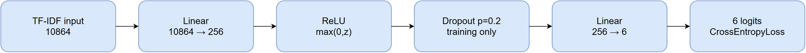
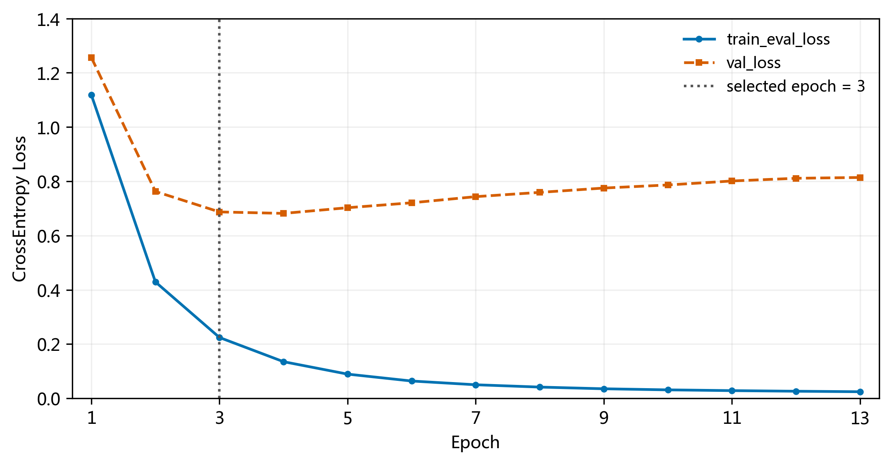
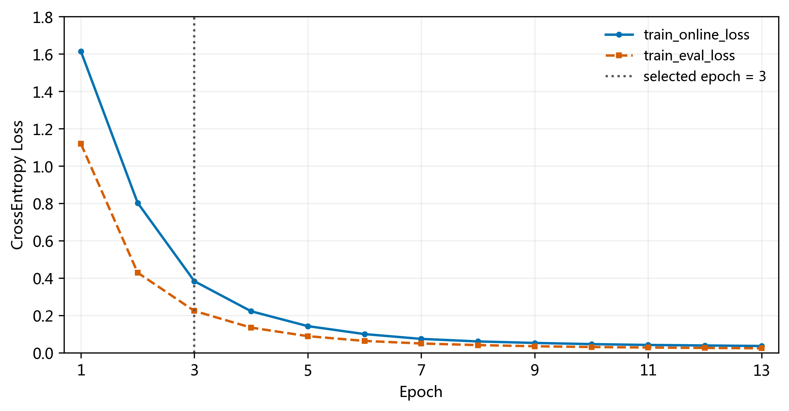
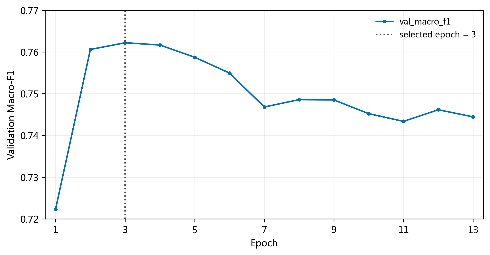
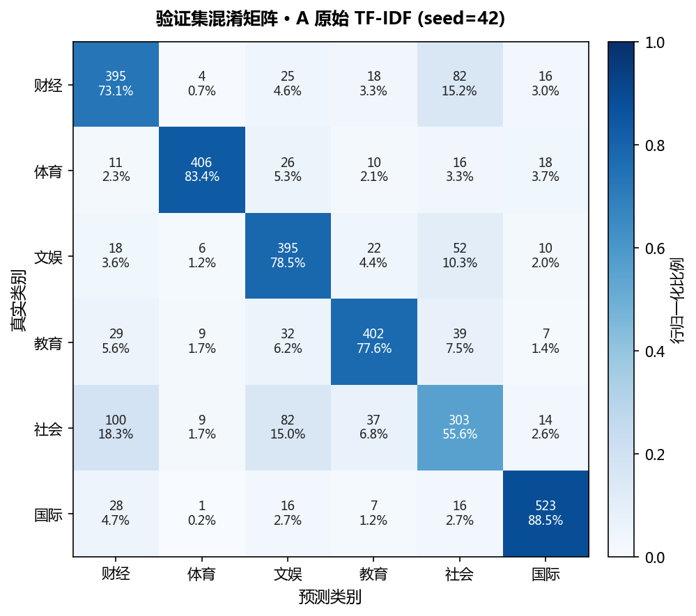

# 成员 A：原始 BP 神经网络 Baseline 专项审计与完善

本报告覆盖第 1～3 章。B0 指原始 TF-IDF 输入的既定实验基线（代码实验 ID `A_raw`），不是“未经任何现代训练技术改动的经典 BP”。代码中的 A/B/C 是特征方案编号，与成员 A/B/C 的分工不同。本报告不报告成员 B、C 的研究成果。

## 第 1 章 绪论

### 1.1 研究背景

新闻分类把文本映射到主题类别，可用于信息整理、检索和推荐。本项目使用中文新闻标题研究六分类：标题长度有限，词语歧义、上下文缺失和频道主题交叉会影响识别。TF-IDF 能提供可复现的词项表示；单隐层多层感知机可学习词项的非线性组合，适合作为课程数值实验的基线。

### 1.2 问题提出与研究目标

成员 A 回答三个问题：既定模型的分类表现与随机初始化稳定性如何；训练拟合改善是否伴随验证性能恶化；哪些类别与标题更容易错分。检验依据分别为五种子结果、同一 epoch 末参数状态下的训练/验证损失，以及验证集逐类别指标与错误标题。不能将所有错误归结于网络容量或正则化，也不能用验证集研究的结果声称独立测试结论。

### 1.3 技术路线与范围

采集标题和元数据 → 清洗及六类映射 → 时间划分 → 仅训练集拟合 TF-IDF → 既定 B0 训练 → 验证集选择 checkpoint → 训练曲线和错分分析。后续研究可据此检验高维特征与泛化问题，但具体方案和结果留给其他成员。

## 第 2 章 数据集与原始 BP 算法

### 2.1 数据集

数据来自中国新闻网历史滚动新闻归档，仅使用标题作为模型输入，不使用正文、URL、时间或频道字段作为特征。采集区间为 2025-01-01～2026-10-31。正式数据版本 1.1.0，共 12,000 条，六类各 2,000 条。原始频道“文化”映射为“文娱”，其操作性含义包括文学、艺术、文博、非遗等，不能等同于狭义娱乐。

| 划分 | 时间范围 | 财经 | 体育 | 文娱 | 教育 | 社会 | 国际 | 合计 |
|---|---|---:|---:|---:|---:|---:|---:|---:|
| train | 2025-01-01～2025-12-31 | 1109 | 1107 | 1134 | 1064 | 1057 | 1078 | 6549 |
| val | 2026-01-01～2026-06-30 | 540 | 487 | 503 | 518 | 545 | 591 | 3184 |
| test（版本登记） | 2026-07-01～2026-10-31 | 351 | 406 | 363 | 418 | 398 | 331 | 2267 |

按时间划分用于考察跨时间泛化。全数据平衡不代表每个子集严格平衡；数据来自单一来源，均衡配额也不同于自然新闻流的类别比例。时间变化和同系列近重复可能影响泛化。原审计记录显示 ID、URL 和精确标题跨集合无交集；本次未重做测试集内容分析。

### 2.2 数据预处理

原清洗流程规范空白、换行和不可见字符，剔除空标题、非内容链接及时间异常记录，按 URL 和完全相同标题去重，只保留六类映射，并按日期等距抽样控制每类配额。清洗层保留标题标点；建模时 jieba 精确分词，过滤不含中文或拉丁字母的 token（包括标点和纯数字），纯英文 token 转小写。不额外去停用词。两阶段处理不同，报告不能混写为“原数据已删除全部数字和标点”。本次不改样本或标签。

### 2.3 TF-IDF 特征

训练集拟合词表和 IDF，验证集只 transform。参数为 `min_df=2, max_df=0.95, max_features=20000, ngram_range=(1,2), sublinear_tf=True, norm=l2, smooth_idf=True, lowercase=False`，tokenizer 接收已分词列表。20000 是词表上限，筛选后的实际维度为 10864。

对词项 t 和标题 d，令次数为 c：非零 TF 为 `1+ln(c)`，平滑 IDF 为 `ln((1+N)/(1+df(t)))+1`，两者乘积再对每条标题做 L2 归一化。词项包含一元词和相邻二元词组；未见词不会增加验证集输入维度。标题较短时，稀疏性和未知词可能限制信息表达。本次没有计算未知词率，不能宣称其是主要致错原因。

### 2.4 单隐层 BP 网络原理与定义

本项目使用单隐层多层感知机，通过反向传播计算梯度，并使用 Adam 优化器更新网络参数。BP 是梯度计算机制，Adam 是更新规则；虽然学习率超参数固定为 0.001，Adam 的自适应更新不等于经典固定步长普通梯度下降。

前向过程为 `h=ReLU(W1 x+b1)`，训练时 `h_drop=m*h/(1-p)`，`z=W2 h_drop+b2`，其中 m 是保留概率 0.8 的 Bernoulli 掩码。评估时禁用 Dropout。输出是六个 logits，预测取最大 logit 对应类别。

ReLU 为 `max(0,z)`，提供非线性表达；Dropout 在训练时随机屏蔽隐藏单元，旨在降低共同适应，并不保证消除过拟合。CrossEntropyLoss 对 logits 计算数值稳定的 log-softmax 与负对数似然，`L=-mean(log(exp(z_y)/sum(exp(z_k))))`；模型无需显式再加 softmax。

反向传播按链式法则得到梯度，代码将总梯度范数裁剪到 5。Adam 使用梯度的一阶、二阶矩估计及偏差修正来自适应更新。这里使用 `torch.optim.Adam` 的默认耦合 L2 weight decay：更新计算中加入权重惩罚，覆盖全部传给优化器的参数（包括偏置），不是 AdamW。Weight Decay 旨在约束参数幅度。图中的 Dropout 为已有隐藏层正则化。



可编辑图源：[network.drawio](../results/member_A_audit_20261105/A_raw_s42/network.drawio)。图源若未导出 PNG，可在 draw.io 打开；Markdown 的结构表示为：


参数量：第一层 `10864×256+256=2,781,440`；输出层 `256×6+6=1,542`；合计 **2,782,982**。ReLU、Dropout 和损失函数无可训练参数。模型参数数量远多于 6,549 条训练样本，但仅此不能证明过拟合，需要曲线佐证。

### 2.5 固定实验设置与记录方法

| 项目 | 值 |
|---|---|
| 网络 | 10864 → Linear 256 → ReLU → Dropout 0.2 → Linear 6 |
| 损失与优化器 | CrossEntropyLoss；Adam |
| lr / weight_decay | 0.001 / 0.0001 |
| Batch / 最大 epoch | 64 / 100 |
| 早停 | 验证 Macro-F1 超过已存最优值 + 0.0001 才算改善；patience=10 |
| 梯度裁剪 | max_norm=5.0 |
| 历史种子 / 本次种子 | 42、43、44、45、46 / 42 |
| 环境 | Python 3.12.4；PyTorch 2.8.0+cpu；CPU，16 线程 |

Accuracy 为正确数/总数；每类 Precision=TP/(TP+FP)，Recall=TP/(TP+FN)，F1=2PR/(P+R)，Macro 指六类等权平均；Weighted F1 按真实样本量加权。本次只补充测量，不调参。

原来的 `train_loss` 是训练模式下各批次、不同更新状态的样本加权在线损失，现在明确命名 `train_online_loss`。新增 `evaluate_training_set` 在每轮全部更新完成后用 eval/no_grad 在完整训练集分批计算 `train_eval_loss`；验证集紧接着以相同参数状态、相同 eval 模式、同样 512 的评估 batch 和 CrossEntropyLoss 计算 `val_loss`。两者均按样本数加权，不包含 weight decay 惩罚。二者之间无更新；下一轮重新切换 train 模式。

保留 `train_loss=train_online_loss`、`val_f1_macro=val_macro_f1` 作为旧程序兼容别名。历史文件未补造 eval loss。新 `epoch_time` 包含额外训练集评估成本，不能直接与历史计时解释为训练算法变慢。

## 第 3 章 Baseline 实验与问题分析

### 3.1 五随机种子 Baseline

以下为历史 JSON 的直接汇总；没有重跑五种子，也没有运行测试集评估。

| seed | best_epoch | val_accuracy | val_precision_macro | val_recall_macro | val_f1_macro | val_f1_weighted | historical_test_f1_macro |
| --- | --- | --- | --- | --- | --- | --- | --- |
| 42 | 3 | 0.7613 | 0.7659 | 0.7612 | 0.7622 | 0.7621 | 0.7360 |
| 43 | 4 | 0.7585 | 0.7670 | 0.7581 | 0.7616 | 0.7614 | 0.7377 |
| 44 | 3 | 0.7651 | 0.7693 | 0.7650 | 0.7659 | 0.7657 | 0.7370 |
| 45 | 3 | 0.7635 | 0.7683 | 0.7632 | 0.7649 | 0.7647 | 0.7394 |
| 46 | 3 | 0.7597 | 0.7647 | 0.7597 | 0.7600 | 0.7598 | 0.7356 |

| 指标 | 均值 | 样本标准差(ddof=1) |
| --- | --- | --- |
| val_accuracy | 0.7616 | 0.0027 |
| val_precision_macro | 0.7670 | 0.0018 |
| val_recall_macro | 0.7614 | 0.0027 |
| val_f1_macro | 0.7629 | 0.0024 |
| val_f1_weighted | 0.7627 | 0.0024 |
| historical_test_f1_macro | 0.7372 | 0.0015 |

均值±样本标准差：Validation Macro-F1 **0.7629±0.0024**、Accuracy **0.7616±0.0027**；历史 Test Macro-F1 **0.7372±0.0015**。标准差为 ddof=1，n=5，仅反映固定划分下训练随机性，不是置信区间，也不涵盖数据抽样变化。测试集第一轮已在多个配置中被评估，本次仅引用历史值，不用它进行配置选择或优化。

### 3.2 本次种子 42 的完整训练历史

| epoch | train_online_loss | train_eval_loss | val_loss | eval_loss_gap | val_macro_f1 | val_accuracy |
| --- | --- | --- | --- | --- | --- | --- |
| 1 | 1.612239 | 1.117927 | 1.255759 | 0.137833 | 0.722344 | 0.738065 |
| 2 | 0.802491 | 0.428968 | 0.762382 | 0.333413 | 0.760584 | 0.760050 |
| 3 | 0.383319 | 0.224267 | 0.687028 | 0.462761 | 0.762195 | 0.761307 |
| 4 | 0.222595 | 0.135115 | 0.681630 | 0.546515 | 0.761641 | 0.758794 |
| 5 | 0.142950 | 0.089318 | 0.702545 | 0.613227 | 0.758716 | 0.756910 |
| 6 | 0.100431 | 0.063918 | 0.720681 | 0.656763 | 0.754923 | 0.753141 |
| 7 | 0.074708 | 0.050123 | 0.743338 | 0.693215 | 0.746806 | 0.745917 |
| 8 | 0.061072 | 0.041559 | 0.759082 | 0.717523 | 0.748573 | 0.746545 |
| 9 | 0.053064 | 0.035329 | 0.775040 | 0.739710 | 0.748501 | 0.746859 |
| 10 | 0.046796 | 0.031326 | 0.786361 | 0.755035 | 0.745209 | 0.744347 |
| 11 | 0.042285 | 0.028511 | 0.801039 | 0.772528 | 0.743367 | 0.742462 |
| 12 | 0.039529 | 0.026288 | 0.811026 | 0.784738 | 0.746143 | 0.744347 |
| 13 | 0.036709 | 0.024436 | 0.814027 | 0.789591 | 0.744446 | 0.742776 |

最佳 epoch=3（Macro-F1=0.762195）；验证 loss 最小在 epoch=4（0.681630），两者不相同，因为选模指标固定为 Macro-F1。epoch 4～13 均未超过已存最优 Macro-F1+0.0001，于第 13 轮满足 `epoch-best_epoch=10`，早停并恢复第 3 轮权重。早停不是因为 loss 上升直接触发。







训练 eval loss 从 1.117927 单调下降到 0.024436；验证 loss 从 1.255759 降至第 4 轮的 0.681630，随后逐轮上升至 0.814027。第 3 轮的 eval 泛化差距为 0.462761，第 4 轮为 0.546515，第 13 轮为 0.789591。验证 Macro-F1 从最佳 0.762195 降至最后的 0.744446，下降约 1.775 个百分点。这组同状态、同模式的曲线支持**后期训练存在明显过拟合**；早停保留了较好的验证 checkpoint。时间分布变化和频道交叉可能共同影响泛化差距，不能从这一次实验判定全部原因或最优修正手段。

在线 loss 与 eval loss 不能直接互换：前者包含训练过程中较早的参数状态和 Dropout，后者用 epoch 末参数并关闭 Dropout。本次两者差异不能单独解释为“Dropout 带来的损失”，因为参数更新状态也不同。

### 3.3 验证集混淆矩阵与逐类别表现

以下预测来自**历史 `results/runs/A_raw_s42/model.pt` 的最佳 checkpoint**，复用历史特征流水线，仅对验证集推理。预测混淆矩阵与历史保存值完全一致，也与本次重训预测一致。

| 真实\预测 | 预测_财经 | 预测_体育 | 预测_文娱 | 预测_教育 | 预测_社会 | 预测_国际 |
| --- | --- | --- | --- | --- | --- | --- |
| 真实_财经 | 395 | 4 | 25 | 18 | 82 | 16 |
| 真实_体育 | 11 | 406 | 26 | 10 | 16 | 18 |
| 真实_文娱 | 18 | 6 | 395 | 22 | 52 | 10 |
| 真实_教育 | 29 | 9 | 32 | 402 | 39 | 7 |
| 真实_社会 | 100 | 9 | 82 | 37 | 303 | 14 |
| 真实_国际 | 28 | 1 | 16 | 7 | 16 | 523 |

行是真实类别、列是预测类别；对角线合计 2424/3184。混淆矩阵各行数量对应验证集 support。



| 类别 | precision | recall | f1 | support |
| --- | --- | --- | --- | --- |
| 财经 | 0.6799 | 0.7315 | 0.7047 | 540.0000 |
| 体育 | 0.9333 | 0.8337 | 0.8807 | 487.0000 |
| 文娱 | 0.6858 | 0.7853 | 0.7322 | 503.0000 |
| 教育 | 0.8105 | 0.7761 | 0.7929 | 518.0000 |
| 社会 | 0.5965 | 0.5560 | 0.5755 | 545.0000 |
| 国际 | 0.8895 | 0.8849 | 0.8872 | 591.0000 |

社会最难分类，F1=0.5755，Recall=0.5560；其次为财经 F1=0.7047、文娱 F1=0.7322。教育 F1=0.7929，体育与国际分别为 0.8807、0.8872。此排序对应固定种子 42 的验证集，不将其冒充为五种子的逐类平均。

### 3.4 主要混淆方向

| category | predicted_category | count | true_class_rate |
| --- | --- | --- | --- |
| 社会 | 财经 | 100 | 0.1835 |
| 社会 | 文娱 | 82 | 0.1505 |
| 财经 | 社会 | 82 | 0.1519 |
| 文娱 | 社会 | 52 | 0.1034 |
| 教育 | 社会 | 39 | 0.0753 |
| 社会 | 教育 | 37 | 0.0679 |
| 教育 | 文娱 | 32 | 0.0618 |
| 教育 | 财经 | 29 | 0.0560 |
| 国际 | 财经 | 28 | 0.0474 |
| 体育 | 文娱 | 26 | 0.0534 |
| 财经 | 文娱 | 25 | 0.0463 |
| 文娱 | 教育 | 22 | 0.0437 |
| 体育 | 国际 | 18 | 0.0370 |
| 文娱 | 财经 | 18 | 0.0358 |

`true_class_rate` 为方向计数/该真实类别样本量，非所有错误中的占比。社会→财经 100、财经→社会 82，双向共 182；社会↔文娱共 134；教育↔社会共 76；财经↔文娱共 43。社会与财经、文娱的交叉最突出；教育→文娱等其他方向也保留在完整 CSV 中，未选择性隐藏。

### 3.5 20 条典型错分标题

抽样规则：预先列出以上四对类别的八个方向，按发布时间和 ID 排序；社会↔财经、社会↔文娱每方向取前三条，财经↔文娱、教育↔社会每方向取前两条，共 20 条。它们是方向覆盖的案例，不是随机样本，也不用于估计错误类型比例。时间靠前的确定性取样有时段偏倚，不能代表所有月份。未使用测试样本。

| 样本ID | 新闻标题 | 真实类别 | 预测类别 | 错误类型 | 简要分析 |
| --- | --- | --- | --- | --- | --- |
| cn10544815 | 全国铁路计划加开旅客列车785列 这些方向余票充足 | 社会 | 财经 | 频道语义交叉 | 铁路加开同时涉及公共出行与运输经济；标题无法确定频道侧重。 |
| cn10545163 | 科技促产业崛起 广西罗汉果从桂林山野走向欧美市场 | 社会 | 财经 | 频道语义交叉 | 产业、欧美市场具有财经线索，但源频道按地方社会新闻收录。 |
| cn10545374 | 年轻人社交新实验：“一次聊天”换来“长期技能” | 社会 | 财经 | 模型特征提取不足（候选） | 标题明确出现社交实验，财经关联较弱；可能未充分利用词项组合，须进一步解释模型才可归因。 |
| cn10546164 | 变民生蓝图为幸福实景 | 财经 | 社会 | 标题信息不足 | 民生蓝图和幸福实景较抽象，标题缺少经济政策、主体与具体事件信息。 |
| cn10547393 | 新年伊始 入境游持续火热 | 财经 | 社会 | 频道语义交叉 | 入境游同时属于旅游产业和生活社会主题，标题没有给出收入或消费数据。 |
| cn10548206 | SNH48母公司丝芭擅自出版被罚 | 财经 | 社会 | 频道语义交叉 | 公司、出版、处罚横跨企业经营、文化与社会监管；预测受处罚事件叙事影响是合理假设。 |
| cn10544262 | 夜游逛馆、看戏迎新 京津冀跨年更添“文化味” | 社会 | 文娱 | 频道语义交叉 | 看戏、文化味是文化线索，真实社会频道侧重群众跨年活动。 |
| cn10544460 | 文博启新元 中国多地民众走进博物馆共度跨年夜 | 社会 | 文娱 | 频道语义交叉 | 博物馆、文博偏文化，民众跨年偏社会，两种主题在同一标题并存。 |
| cn10546236 | 左手抹布右手笔 57岁家政工把生活写成书绘成画 | 社会 | 文娱 | 频道语义交叉 | 家政工身份与生活故事偏社会，写书绘画偏文化，短标题兼具两者。 |
| cn10544388 | 浙江卫视跨年晚会实现4K超高清频道大型直播 | 文娱 | 社会 | 频道语义交叉 | 晚会属于文化内容，超高清频道直播又是技术和传播事件；模型可能偏重技术侧词项。 |
| cn10550352 | 捐出去的藏品不该成为“泼出去的水” | 文娱 | 社会 | 标题信息不足 | 藏品提供文化线索，但修辞化表述没有说明博物馆或事件背景。 |
| cn10550548 | 闫学晶母子先后道歉，为何难获谅解？ | 文娱 | 社会 | 标题信息不足 | 人名和道歉事件缺少身份背景，单凭标题难区分娱乐新闻与一般社会争议。 |
| cn10544218 | 新年贺词里的140万亿 | 财经 | 文娱 | 模型特征提取不足（候选） | 140万亿是重要经济信号，但纯数字过滤会移除140，剩余万亿及贺词未必足以表征财经；未做消融验证。 |
| cn10546839 | 浙江传统服装企业跨界破圈 国潮娃衣出海圈粉 | 财经 | 文娱 | 频道语义交叉 | 企业和出海偏财经，国潮娃衣偏文化消费，模型可能突出后者。 |
| cn10547069 | 四部门发文推动职工文体消费 明确春秋游每年最多四次 | 文娱 | 财经 | 频道语义交叉 | 文体活动属于文化，消费和部门政策又属于财经语义，频道边界本身交叉。 |
| cn10547811 | 中国大百科全书出版社推出以“中国百科网”为核心数字矩阵产品 | 文娱 | 财经 | 频道语义交叉 | 出版社、百科全书属于文化，数字产品与矩阵又接近企业产品报道。 |
| cn10550271 | 如何引导孩子合理使用“网络梗”？专家支招 | 教育 | 社会 | 频道语义交叉 | 孩子、引导属于教育，网络梗及生活指导也常见于社会频道。 |
| cn10556668 | 中国学者成功开发“纤维芯片”：丝线般细软、为纤维电子系统集成提供新路径 | 教育 | 社会 | 可能的标签噪声／频道口径差异（待核查） | 标题偏科研技术，教育频道可能依据高校主体归类；标题未交代机构，不能认定原标签错误。 |
| cn10550222 | 补短板、优服务、稳收益——把家门口就业好事办好 | 社会 | 教育 | 频道语义交叉 | 就业与公共服务属于社会议题，也与职业教育相邻；标题缺少学校和培训线索。 |
| cn10552791 | “智能”养宠背后的伪科技与真痛点 | 社会 | 教育 | 模型特征提取不足（候选） | 养宠和消费痛点更接近社会生活，教育线索较弱；不能仅凭标题断言具体致错词。 |

定性判断仅依据标题和频道标签。表中“模型特征提取不足”均是待验证候选，未做特征归因或反事实实验；“标签噪声”必须通过原始频道和正文语境复核，本次只有一个待核查例，不能据此判定误标。频道交叉是任务边界问题，标题信息不足是输入限制，二者不等于模型实现错误。所有真实标签均原样保留。

### 3.6 Baseline 问题与后续研究动机

1. 高维输入带来 278 万参数，而训练样本仅 6549 条。模型容量、特征冗余及计算开销值得检验，但本报告尚未证明何种降维方法更优。
2. 同口径训练/验证损失及验证 Macro-F1 显示后期过拟合；已有 Dropout、weight decay 与早停仍不能阻止后期分化。可据此提出进一步受控研究，不能预设新方法必然有效。
3. 社会与财经、文娱的边界交叉突出，改网络不一定能解决频道本身的语义重叠。标题中的隐含身份与事件背景也可能限制分类上限。
4. 固定时间划分、单一新闻来源和均衡配额限制外推；五种子稳定不能替代跨来源或跨时间窗口验证。
5. 历史测试结果已经接触，后续方法选择必须继续依据验证集，并明确这一限制；如将来需要新的独立泛化结论，应另行制定评估方案，本次不实施。

目前 B0 已有可追溯配置、五种子指标、完整训练历史、逐类指标与案例，足以作为后续受控研究的基线。它不能单独证明任何后续改进的有效性。

## 审计记录、复现与尚缺内容

基准提交：`8f02aebe1783ec1067dccc7b32bfa1a402ebdd5f`；训练开始时的工作区状态、逐源码 SHA256、训练/验证文件 SHA256、TF-IDF 参数和环境见 [metrics.json](../results/member_A_audit_20261105/A_raw_s42/metrics.json)。新实验创建时间原始字段为 `2026-11-05 01:32:38`；主机日志日期与用户时区可能不同，目录日期与本报告按用户 Asia/Shanghai 的 2026-11-05 标识。训练参数及随机种子均未修改。

本次逐轮 online loss、val loss、val F1、val accuracy 与历史记录的最大绝对差均为 0；epoch 数、最佳 epoch 和验证预测一致，见 [reproduction_check.json](../results/member_A_audit_20261105/A_raw_s42/reproduction_check.json)。这为“新增评估未改变该次优化轨迹”提供直接证据。

训练入口新增 `--output-root`，不重建历史汇总；已存在运行目录在训练前拒绝覆盖。数据加载新增 splits 参数，训练入口明确只加载 train/val；原函数默认加载所有划分，与入口文档不符的问题已修正。新增两个行为测试：不整除 batch 下的加权损失、关闭 Dropout/无梯度/无 RNG 或参数变化，以及训练加载不打开 test.csv。

首次运行已完成并保存全部产物，但在最后输出相对路径的日志行发生异常，因此 shell 返回非零。该显示问题已用 resolve 修正；未为修正日志重复训练。保存后完整性与历史重现检查均通过。随后还修正了数据校验文件句柄关闭；这两项不影响本次训练数值，执行时源码哈希与最终源码可能因此不同。原日志保留为 `execution_original.log`，不伪造成功运行日志。

复现命令（已存在目录会拒绝覆盖；重跑请使用新的输出根目录）：

```powershell
python train_bp.py --exp A_raw --seeds 42 --output-root results/member_A_audit_20261105
python audit_member_A.py
python report_member_A.py
python -m unittest discover -s tests -v
```

原始日志、源代码补丁和完整性清单随新目录保存；目录中的 test 字段为 null，本次未运行 evaluate_test.py。历史五种子文件中的测试数值仅为既有 JSON 的抄录。原数据 SHA256 登记值为 `29f4827b4a946fbfdba292b5259ffcc4607486f4d27aaf65c9c42f805b250cc4`。

第 1～3 章的实验证据和内容框架已补齐。正式提交仍需补充并核实相关研究文献及规范引用，按课程要求整合排版与图表编号；如要断言标签噪声或具体模型致错机制，还需要人工溯源/特征解释证据。课程是否要求手推 BP 更新公式应再对照评分标准，目前给出了前向、损失与反向传播机制，未声称手写 BP 或普通 SGD。
