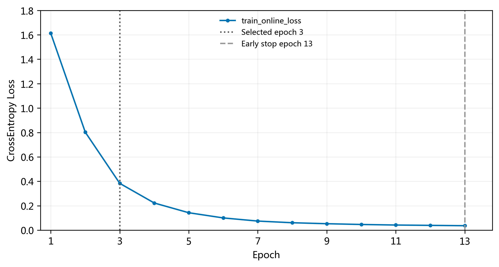
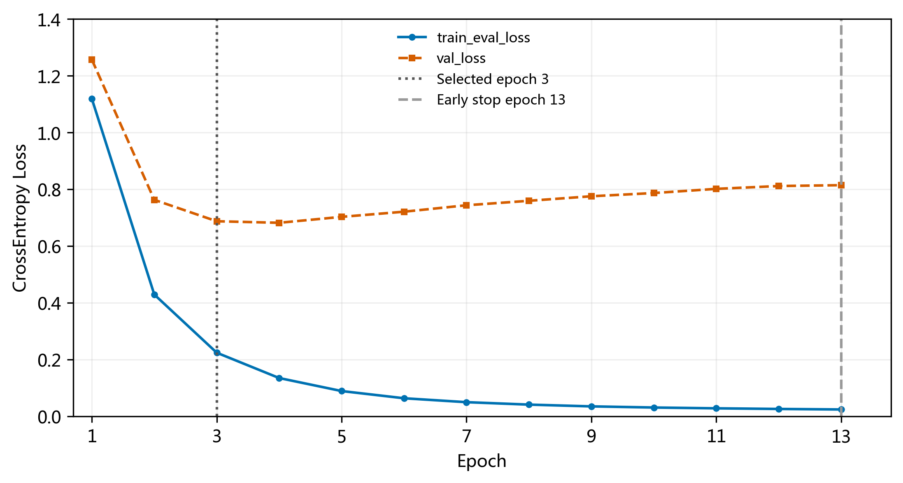
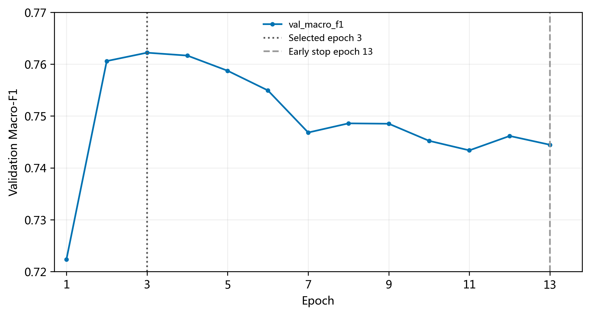

# 成员 A：Baseline 整改验收报告

本轮基准提交为 `de5558bce442423cad07e619ccda357ccb7dcde6`，任务来源为 docs/成员A_Baseline整改任务书.md。工作范围仅成员A，第1～3章；原 [Baseline正文与算法说明](member_A_baseline_audit.md) 及上一轮所有产物保留不变。本报告提供本轮整改差异与验收证据，数据风险和错误分析分别由链接报告维护，避免混淆历史与本轮实验。

## P0 / P1 / P2 审计发现及处理

| 优先级 | 发现 | 修复与证据 |
|---|---|---|
| P0 | 测试入口缺少SHA256校验 | evaluate_test.load_test_split在读CSV前校验test指纹；仅用临时损坏文件测试阻断，不执行实际测试预测 |
| P0 | 完整性脚本缺少显式URL交集、固定版本和索引检查 | verify_dataset.py补齐；日志通过。未改任何正式CSV |
| P0 | 原记录无本轮源码下的成功训练日志 | 独立目录运行完整B0 s42，训练入口返回0，运行时test.csv读取尝试为0 |
| P1 | 只有2个既有行为测试 | 扩展为8项，覆盖加权eval、无梯度/参数/RNG变化、Dropout关闭、fit范围、指纹异常、防覆盖、最佳权重恢复、数字诊断与LR加载范围 |
| P1 | 原图未标早停轮次、缺逐类别图 | 本轮图标注选择轮次3和早停13；补充P/R/F1点图 |
| P1 | FeatureBuilder文档过度承诺API强制训练集fit | 修正文档；实际由入口调用边界与集成测试保证 |
| P1 | LR入口即使no-test也经默认loader读取Test | 改为只加载train/val，实际测试读取仅走已加指纹门禁的测试入口；本轮没有重训LR |
| P2 | 未量化分词和词表覆盖、错误归因证据不足 | 新增分词/OOV/空文档诊断、20例完整非零特征，将无证据“模型问题”标为暂无法判断 |
| P2 | 数据局限和交接材料不完整 | 单一来源、文化映射、去重、近重复及历史测试接触均单独记录，并给B/C交接清单 |

## 固定配置与实际复现

TF-IDF维度10864；单隐层256/ReLU/Dropout0.2/6 logits；CrossEntropyLoss和Adam；lr=0.001、weight_decay=0.0001、batch=64、max_epochs=100、patience=10、min_delta=0.0001、clip=5；seed=42；参数量2,782,982。没有新增Softmax，没有改网络、损失、分词或超参数。

损失记录沿用已完成修复：在线loss来自训练过程；train_eval_loss和val_loss在每轮末、无更新间隔、eval/no_grad模式下按样本数加权计算。历史缺失的eval loss没有补造。

本轮最佳epoch **3**，共 **13** 轮，验证Macro-F1 **0.762195**、Accuracy **0.761307**。逐轮online loss、val loss、val F1和val accuracy与历史结果的最大绝对差均为 **0**（声明容差0），验证预测、混淆矩阵、参数量一致。详见 [reproduction_check.json](../results/member_A_baseline_recheck/reproduction_check.json) 和 [training.log](../results/member_A_baseline_recheck/training.log)。本轮metrics.test为null；训练运行时尝试读取Test次数为0。

## 五随机种子：历史结果重算

| seed | best_epoch | epochs_run | val_accuracy | val_precision_macro | val_recall_macro | val_f1_macro | val_f1_weighted |
| --- | --- | --- | --- | --- | --- | --- | --- |
| 42 | 3 | 13 | 0.7613 | 0.7659 | 0.7612 | 0.7622 | 0.7621 |
| 43 | 4 | 14 | 0.7585 | 0.7670 | 0.7581 | 0.7616 | 0.7614 |
| 44 | 3 | 13 | 0.7651 | 0.7693 | 0.7650 | 0.7659 | 0.7657 |
| 45 | 3 | 13 | 0.7635 | 0.7683 | 0.7632 | 0.7649 | 0.7647 |
| 46 | 3 | 13 | 0.7597 | 0.7647 | 0.7597 | 0.7600 | 0.7598 |

| metric | mean | sample_std_ddof1 | n |
| --- | --- | --- | --- |
| val_accuracy | 0.761621 | 0.002693 | 5 |
| val_precision_macro | 0.767042 | 0.001826 | 5 |
| val_recall_macro | 0.761448 | 0.002721 | 5 |
| val_f1_macro | 0.762915 | 0.002412 | 5 |
| val_f1_weighted | 0.762716 | 0.002420 | 5 |

采用样本标准差ddof=1、n=5；验证Macro-F1为0.7629±0.0024、Accuracy为0.7616±0.0027。seed43在第4轮最优，其余四种子均为第3轮；这说明最优轮次也受训练随机性影响。本轮只重训seed42，五种子均值来自既有原始JSON，不伪称重跑五次。标准差反映固定数据划分下随机初始化/训练波动，不是抽样置信区间。

## 训练过程与过拟合







同模式训练eval loss在第1/3/4/13轮分别为1.117927/0.224267/0.135115/0.024436；val loss分别为1.255759/0.687028/0.681630/0.814027。第3轮与第13轮损失差距分别0.462761和0.789591。第4轮之后训练loss继续下降、验证loss持续回升，验证F1由最佳0.762195降至0.744446，支持明显后期过拟合。模型参数多于样本只是风险因素，此处结论由曲线与指标共同支持，不由参数量单独推导。

最佳Macro-F1在第3轮，最低val loss在第4轮，二者衡量不同。早停仅依据F1超过已存最优+min_delta，连续10轮无改善后在第13轮终止，恢复第3轮权重。验证loss上升不是早停条件。时间变化、标题信息和频道交叉也可能贡献泛化差距，不能声称所有差距由某一种原因造成。

## 分类、特征和数据诊断

参见 [验证错误与特征分析](member_A_error_analysis.md)（完整20例、类别图与混淆矩阵）以及 [数据与特征局限](member_A_data_limitations.md)。社会类最难，F1=0.5755；财经0.7047、文娱0.7322。训练平均token数9.775，验证9.884；验证token出现次数OOV率24.56%。这些描述是诊断证据，不能单独证明数字处理或词表覆盖造成性能瓶颈。

网络结构图复用 [上一轮图源](../results/member_A_audit_20261105/A_raw_s42/network.drawio) 和 [PNG](../results/member_A_audit_20261105/A_raw_s42/network.png)，模型定义无变化，无需重复绘图。

## 固定参数Logistic Regression参考

历史LR使用相同时间划分、同一FeatureBuilder('A')、相同训练集fit流程，特征信息为10864维、6549训练行；C=1.0、lbfgs、max_iter=2000，没有系统调参。本轮核查代码和结果元数据，未重新拟合LR或测试。LR验证F1=0.751324，与BP seed42的差为0.010871（约1.087个百分点）。这是单配置参考差异，不能宣称胜过经过充分优化的最强传统分类器，也未进行配对显著性检验。

LR历史测试F1约0.7183、B0五种子历史测试F1约0.7372，仅注明既有记录，不参与本轮选择、诊断模型优化或重新评估。历史LR未保存特征流水线本体，本轮不能独立证明其历史词表逐项相同，只能核对共用代码、数据路径和元信息。

## 修改文件与理由

| 文件 | 目的 |
|---|---|
| evaluate_test.py | 实际Test读取前检查指纹 |
| verify_dataset.py | 补齐版本、索引、URL及规模验收项；重复调用清空检查列表 |
| baseline_lr.py | 训练与--no-test不再加载Test |
| models/features.py | 更正API不能鉴别集合来源的文档承诺，算法不变 |
| models/plots.py、train_bp.py | 标注真实选模与早停轮次，优化过程不变 |
| tests/test_baseline_audit.py | 增加fit边界、损坏指纹、防覆盖和恢复权重测试 |
| tests/run_training_without_test.py | 完整训练期间禁止实际读取test.csv |
| recheck_member_A.py、member_A_recheck_report.py | 独立复现、数据/特征诊断、验收报告和图表 |
| 新增三份报告 | 本轮验收、数据局限、错误证据与交接；保留历史报告 |

## 给成员B/C的交接清单

共同基准：v1.1.0/划分1.0.0、B0上述配置、固定种子集42～46；原始训练/验证文件指纹见data_integrity.json，指标见five_seed_summary.csv，曲线及混淆矩阵见本轮目录。

| 接手人 | 有证据的问题 | 后续应控制的条件与边界 |
|---|---|---|
| B | 10864维对应278万参数；词项覆盖、数字过滤与专名切分存在可观察限制 | 研究特征维度/卡方/SVD的判别信息与成本，字符n-gram或保留数字只能单列补充实验；A不选算法或维度 |
| B | 不同特征表示可能改变表示信息和计算量 | 若解释历史SVD下降需核对维度、标准化等变量；本报告不据历史测试选型，也不给出优劣结论 |
| C | 同状态loss与验证F1支持后期过拟合 | 固定数据、已选特征、其余训练条件，对Input Dropout等候选做受控研究；A不实施改进 |
| C | 单种子成功不足以说明稳定改善 | 相同五种子比较验证F1和泛化差距，报告真实涨跌与方差，不能预设有效 |
| 团队 | 社会频道交叉、单一来源及已接触测试集 | 不把所有错误归因于网络；数据变更需共同决定，独立评估问题需另定方案 |

## 验收、复现入口与不能确认的结论

已实际执行完整数据校验、8项自动化测试、B0 s42复现以及特征诊断。日志在独立结果根目录；source_snapshot保留训练阶段源码，analysis_source_snapshot保存随后补充的分析脚本和最终测试版本，metrics记录训练git版本和哈希；保护清单对照本轮开始前所有受保护文件，校验结果见protection_check.json。Test完整性读取与Test模型评估不同，本轮没有后者。

| 任务书验收项 | 状态 | 证据 |
|---|---|---|
| 1 固定且可追溯的B0 | 通过 | preflight.json、A_raw_s42/metrics.json、源码快照 |
| 2 数据与划分完整性 | 通过 | dataset_verification.log（41项）、data_integrity.json |
| 3 特征fit范围 | 通过 | 训练入口测试、实际builder.fit_rows=6549；API本身不能辨识数据来源 |
| 4 固定种子重现 | 通过 | reproduction_check.json，声明容差0 |
| 5 五种子统一统计 | 通过 | five_seed_validation.csv、five_seed_summary.csv，ddof=1 |
| 6 同状态同模式损失 | 通过 | history.csv与无参数/梯度/RNG变化测试 |
| 7 过拟合证据 | 通过 | loss与F1图，选模3/早停13 |
| 8 分类困难与方向 | 通过 | 混淆矩阵、逐类别P/R/F1、方向计数 |
| 9 典型案例依据 | 通过 | 20条真实ID、分词和全部非零特征，未确证因果 |
| 10 数据局限与保护 | 通过 | 数据局限报告、protection_check.json |
| 11 自动化测试与完整性 | 通过 | unit_tests.log、dataset_verification.log |
| 12 独立新结果 | 通过 | member_A_baseline_recheck目录、历史文件哈希对照 |
| 13 B/C交接材料 | 通过 | 本报告交接表；未实施B/C改进 |

```powershell
python recheck_member_A.py run       # 新目录；存在则拒绝覆盖
python recheck_member_A.py analyze   # 本轮诊断与报告
```

正文第1～3章与本轮验收证据已具备；仍需按课程格式整合文献引用与图表编号。正文级错标、同事件近重复、特征因果归因、LR最优性能、跨来源泛化，以及任何B/C改进的有效性均未确认。没有这些证据的条目不标作研究结论；本轮没有通过修改数据或参数提高分数。
