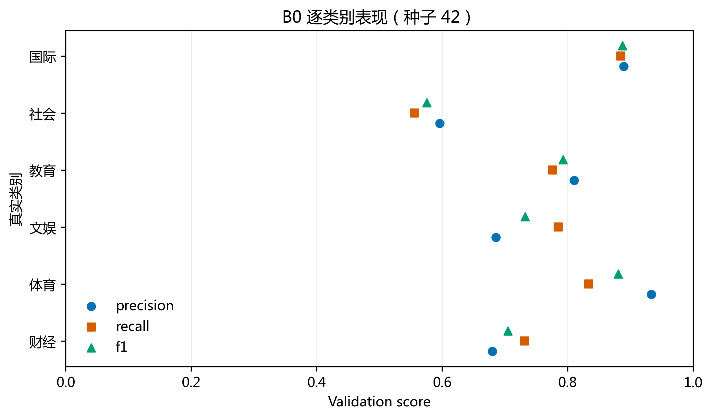
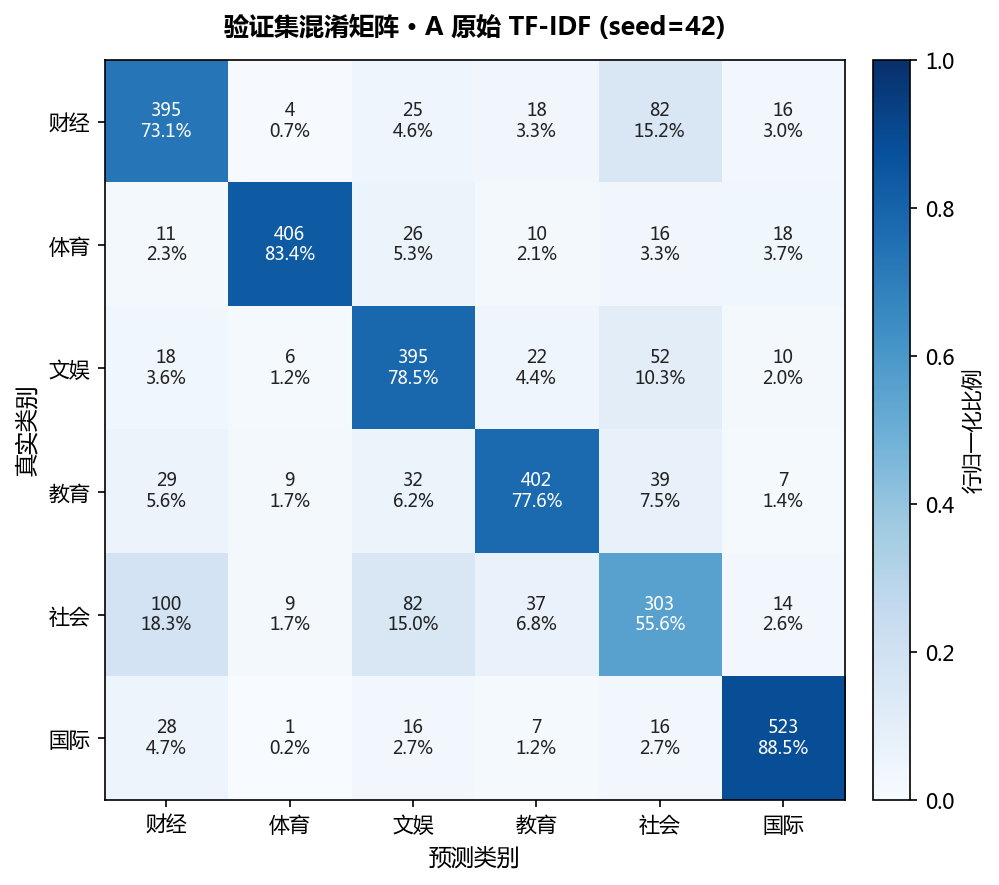

# 成员 A：验证集错误与特征表达诊断

仅使用验证集。20条案例沿用上一轮确定性方向覆盖样本（四个主要方向每个3条、另四个方向每个2条；按时间和ID排序），并给每条附上实际jieba分词、OOV和全部TF-IDF非零特征。预测已与历史最佳checkpoint的已保存验证预测逐条一致核对。取样偏向较早时段，不是随机样本，不估计错误类型占比。

## 分类效果及混淆方向

| category | precision | recall | f1 | support |
| --- | --- | --- | --- | --- |
| 财经 | 0.6799 | 0.7315 | 0.7047 | 540.0000 |
| 体育 | 0.9333 | 0.8337 | 0.8807 | 487.0000 |
| 文娱 | 0.6858 | 0.7853 | 0.7322 | 503.0000 |
| 教育 | 0.8105 | 0.7761 | 0.7929 | 518.0000 |
| 社会 | 0.5965 | 0.5560 | 0.5755 | 545.0000 |
| 国际 | 0.8895 | 0.8849 | 0.8872 | 591.0000 |

社会→财经100、财经→社会82、社会→文娱82、文娱→社会52、教育→社会39、社会→教育37；财经→文娱25、文娱→财经18。社会类别F1最低（0.5755），不能由此认定这些标签错误。

## 20条案例与判断依据

| ID | 标题 | 真实标签 | 预测标签 | 诊断类别 | 判断依据及局限 |
| --- | --- | --- | --- | --- | --- |
| cn10544815 | 全国铁路计划加开旅客列车785列 这些方向余票充足 | 社会 | 财经 | 频道语义交叉 | 铁路加开同时涉及公共出行与运输经济；标题无法确定频道侧重。 |
| cn10545163 | 科技促产业崛起 广西罗汉果从桂林山野走向欧美市场 | 社会 | 财经 | 频道语义交叉 | 产业、欧美市场具有财经线索，但源频道按地方社会新闻收录。 |
| cn10545374 | 年轻人社交新实验：“一次聊天”换来“长期技能” | 社会 | 财经 | 暂无法判断 | 标题明确出现社交实验，财经关联较弱；可能未充分利用词项组合，须进一步解释模型才可归因。 |
| cn10546164 | 变民生蓝图为幸福实景 | 财经 | 社会 | 标题信息不足 | 民生蓝图和幸福实景较抽象，标题缺少经济政策、主体与具体事件信息。 |
| cn10547393 | 新年伊始 入境游持续火热 | 财经 | 社会 | 频道语义交叉 | 入境游同时属于旅游产业和生活社会主题，标题没有给出收入或消费数据。 |
| cn10548206 | SNH48母公司丝芭擅自出版被罚 | 财经 | 社会 | 频道语义交叉 | 公司、出版、处罚横跨企业经营、文化与社会监管；预测受处罚事件叙事影响是合理假设。 |
| cn10544262 | 夜游逛馆、看戏迎新 京津冀跨年更添“文化味” | 社会 | 文娱 | 频道语义交叉 | 看戏、文化味是文化线索，真实社会频道侧重群众跨年活动。 |
| cn10544460 | 文博启新元 中国多地民众走进博物馆共度跨年夜 | 社会 | 文娱 | 频道语义交叉 | 博物馆、文博偏文化，民众跨年偏社会，两种主题在同一标题并存。 |
| cn10546236 | 左手抹布右手笔 57岁家政工把生活写成书绘成画 | 社会 | 文娱 | 频道语义交叉 | 家政工身份与生活故事偏社会，写书绘画偏文化，短标题兼具两者。 |
| cn10544388 | 浙江卫视跨年晚会实现4K超高清频道大型直播 | 文娱 | 社会 | 频道语义交叉 | 晚会属于文化内容，超高清频道直播又是技术和传播事件；模型可能偏重技术侧词项。 |
| cn10550352 | 捐出去的藏品不该成为“泼出去的水” | 文娱 | 社会 | 标题信息不足 | 藏品提供文化线索，但修辞化表述没有说明博物馆或事件背景。 |
| cn10550548 | 闫学晶母子先后道歉，为何难获谅解？ | 文娱 | 社会 | 标题信息不足 | 人名和道歉事件缺少身份背景，单凭标题难区分娱乐新闻与一般社会争议。 |
| cn10544218 | 新年贺词里的140万亿 | 财经 | 文娱 | 分词/特征表达问题 | 140万亿是重要经济信号，但纯数字过滤会移除140，剩余万亿及贺词未必足以表征财经；未做消融验证。 |
| cn10546839 | 浙江传统服装企业跨界破圈 国潮娃衣出海圈粉 | 财经 | 文娱 | 频道语义交叉 | 企业和出海偏财经，国潮娃衣偏文化消费，模型可能突出后者。 |
| cn10547069 | 四部门发文推动职工文体消费 明确春秋游每年最多四次 | 文娱 | 财经 | 频道语义交叉 | 文体活动属于文化，消费和部门政策又属于财经语义，频道边界本身交叉。 |
| cn10547811 | 中国大百科全书出版社推出以“中国百科网”为核心数字矩阵产品 | 文娱 | 财经 | 频道语义交叉 | 出版社、百科全书属于文化，数字产品与矩阵又接近企业产品报道。 |
| cn10550271 | 如何引导孩子合理使用“网络梗”？专家支招 | 教育 | 社会 | 频道语义交叉 | 孩子、引导属于教育，网络梗及生活指导也常见于社会频道。 |
| cn10556668 | 中国学者成功开发“纤维芯片”：丝线般细软、为纤维电子系统集成提供新路径 | 教育 | 社会 | 疑似标签噪声（待核查） | 标题偏科研技术，教育频道可能依据高校主体归类；标题未交代机构，不能认定原标签错误。 |
| cn10550222 | 补短板、优服务、稳收益——把家门口就业好事办好 | 社会 | 教育 | 频道语义交叉 | 就业与公共服务属于社会议题，也与职业教育相邻；标题缺少学校和培训线索。 |
| cn10552791 | “智能”养宠背后的伪科技与真痛点 | 社会 | 教育 | 暂无法判断 | 养宠和消费痛点更接近社会生活，教育线索较弱；不能仅凭标题断言具体致错词。 |

“暂无法判断”用于无充分特征归因证据的案例，替代笼统的“模型未学好”。分词/特征表达问题仅说明观察到输入表示损失，不等于证明它造成了该条错分。“疑似标签噪声”只是待核查项；例如科研内容可能因高校主体而归入教育，缺少正文和编辑依据时不能认定误标。

## 分词和实际非零特征

| ID | 保留tokens | 未覆盖tokens | 非零特征数 | 最高权重特征（最多6项） |
| --- | --- | --- | --- | --- |
| cn10544815 | 全国 / 铁路 / 计划 / 加开 / 旅客列车 / 列 / 这些 / 方向 / 余票 / 充足 | 旅客列车 / 余票 | 9 | 充足=0.3919; 全国 铁路=0.3919; 列=0.3919; 加开=0.3919; 方向=0.3536; 铁路=0.2798 |
| cn10545163 | 科技 / 促 / 产业 / 崛起 / 广西 / 罗汉果 / 从 / 桂林 / 山野 / 走向 / 欧美 / 市场 | 罗汉果 / 山野 / 欧美 | 9 | 崛起=0.4337; 走向=0.3979; 桂林=0.3918; 促=0.3457; 市场=0.2922; 科技=0.2784 |
| cn10545374 | 年轻人 / 社交 / 新 / 实验 / 一次 / 聊天 / 换来 / 长期 / 技能 | 聊天 / 换来 | 7 | 实验=0.4346; 一次=0.4230; 社交=0.4230; 长期=0.3987; 年轻人=0.3568; 技能=0.3540 |
| cn10546164 | 变 / 民生 / 蓝图 / 为 / 幸福 / 实景 |  | 6 | 实景=0.4831; 幸福=0.4671; 蓝图=0.4446; 民生=0.3974; 变=0.3465; 为=0.2698 |
| cn10547393 | 新年伊始 / 入境游 / 持续 / 火热 | 新年伊始 | 3 | 入境游=0.6535; 火热=0.6040; 持续=0.4563 |
| cn10548206 | SNH48 / 母公司 / 丝 / 芭 / 擅自 / 出版 / 被 / 罚 | SNH48 / 母公司 / 擅自 / 罚 | 4 | 芭=0.5646; 丝=0.5314; 出版=0.5196; 被=0.3590 |
| cn10544262 | 夜 / 游逛 / 馆 / 看 / 戏 / 迎新 / 京津冀 / 跨年 / 更添 / 文化 / 味 | 游逛 / 更添 | 9 | 戏=0.3807; 跨年=0.3807; 夜=0.3706; 味=0.3623; 馆=0.3553; 迎新=0.3348 |
| cn10544460 | 文博 / 启新 / 元 / 中国 / 多地 / 民众 / 走进 / 博物馆 / 共度 / 跨年 / 夜 | 共度 | 10 | 启新=0.3918; 跨年=0.3788; 夜=0.3688; 文博=0.3536; 元=0.3257; 民众=0.3086 |
| cn10546236 | 左手 / 抹布 / 右手 / 笔 / 岁家 / 政工 / 把 / 生活 / 写成 / 书 / 绘成 / 画 | 左手 / 抹布 / 右手 / 笔 / 岁家 / 政工 / 写成 / 绘成 | 4 | 画=0.5474; 书=0.5352; 把=0.4616; 生活=0.4482 |
| cn10544388 | 浙江 / 卫视 / 跨年 / 晚会 / 实现 / 4K / 超高 / 清 / 频道 / 大型 / 直播 | 卫视 / 4K / 超高 / 清 / 频道 | 6 | 跨年=0.4811; 晚会=0.4684; 直播=0.4347; 大型=0.4017; 实现=0.3388; 浙江=0.2898 |
| cn10550352 | 捐 / 出去 / 的 / 藏品 / 不该 / 成为 / 泼出去 / 的 / 水 | 捐 / 泼出去 | 6 | 不该=0.4590; 水=0.4590; 藏品=0.4590; 出去=0.4143; 成为=0.3209; 的=0.3054 |
| cn10550548 | 闫学晶 / 母子 / 先后 / 道歉 / 为何 / 难获 / 谅解 | 闫学晶 / 母子 / 先后 / 难获 / 谅解 | 2 | 道歉=0.7927; 为何=0.6097 |
| cn10544218 | 新年贺词 / 里 / 的 / 万亿 | 新年贺词 | 4 | 万亿=0.6303; 里 的=0.5395; 里=0.4891; 的=0.2691 |
| cn10546839 | 浙江 / 传统服装 / 企业 / 跨界 / 破圈 / 国潮 / 娃衣 / 出海 / 圈粉 | 传统服装 / 娃衣 | 7 | 国潮=0.4527; 圈粉=0.4085; 破圈=0.4085; 跨界=0.4085; 出海=0.3623; 企业=0.3061 |
| cn10547069 | 四 / 部门 / 发文 / 推动 / 职工 / 文体 / 消费 / 明确 / 春秋 / 游 / 每年 / 最 / 多 / 四次 | 每年 / 四次 | 14 | 发文 推动=0.3088; 职工=0.3088; 部门 发文=0.3088; 文体=0.3006; 春秋=0.3006; 四=0.2833 |
| cn10547811 | 中国大百科全书出版社 / 推出 / 以 / 中国 / 百科 / 网 / 为 / 核心 / 数字 / 矩阵 / 产品 | 中国大百科全书出版社 / 百科 / 矩阵 | 8 | 网=0.4695; 核心=0.4297; 产品=0.3819; 推出=0.3531; 数字=0.3385; 以=0.3133 |
| cn10550271 | 如何 / 引导 / 孩子 / 合理 / 使用 / 网络 / 梗 / 专家 / 支招 | 梗 | 8 | 合理=0.4130; 引导=0.4130; 支招=0.4130; 使用=0.3930; 网络=0.3390; 孩子=0.2962 |
| cn10556668 | 中国 / 学者 / 成功 / 开发 / 纤维 / 芯片 / 丝线 / 般 / 细软 / 为 / 纤维 / 电子 / 系统集成 / 提供 / 新 / 路径 | 纤维 / 丝线 / 般 / 细软 / 纤维 / 系统集成 | 11 | 芯片=0.3773; 开发=0.3618; 电子=0.3618; 新 路径=0.3236; 学者=0.3182; 成功=0.3133 |
| cn10550222 | 补短 / 板 / 优 / 服务 / 稳 / 收益 / 把 / 家门口 / 就业 / 好事 / 办好 | 稳 / 收益 / 好事 / 办好 | 8 | 优=0.3967; 板=0.3967; 补短=0.3967; 补短 板=0.3967; 家门口=0.3580; 把=0.3149 |
| cn10552791 | 智能 / 养宠 / 背后 / 的 / 伪 / 科技 / 与 / 真 / 痛点 | 养宠 / 伪 / 痛点 | 8 | 科技 与=0.4714; 真=0.4254; 背后 的=0.4254; 背后=0.3658; 智能=0.3351; 科技=0.2926 |

表中只是TF-IDF输入权重最高的最多6项，**不是神经网络特征贡献或解释权重**。每条全部非零项及原始分词保存在 [error_feature_evidence.json](../results/member_A_baseline_recheck/error_feature_evidence.json)，便于复核，未只挑选支持结论的特征。

## 纯数字过滤实例

| ID | 标题 | 过滤纯数字 | 实际保留tokens |
| --- | --- | --- | --- |
| cn10544815 | 全国铁路计划加开旅客列车785列 这些方向余票充足 | 785 | 全国 / 铁路 / 计划 / 加开 / 旅客列车 / 列 / 这些 / 方向 / 余票 / 充足 |
| cn10546236 | 左手抹布右手笔 57岁家政工把生活写成书绘成画 | 57 | 左手 / 抹布 / 右手 / 笔 / 岁家 / 政工 / 把 / 生活 / 写成 / 书 / 绘成 / 画 |
| cn10544218 | 新年贺词里的140万亿 | 140 | 新年贺词 / 里 / 的 / 万亿 |

这些例子证明部分数值信息在建模前被去除；例如140与785的具体数量消失，后续还可能保留万亿、列车等语义。汉字数字词“四”“万亿”仍符合B0保留规则，不能因isnumeric为真就说它们被删除。另在“57岁家政工”实例中，实际得到“岁家 / 政工”，可以观察到跨词边界的切分风险；这仍不是该次误分类的因果证明。是否保留数字或更换分词能改善分类需要另做受控实验，本轮不实施。

## 专有名词、机构和赛事名称

| 诊断词串 | 分词结果 | 训练标题含该串 | 验证标题含该串 | 词表覆盖 |
| --- | --- | --- | --- | --- |
| 中国人民银行 | 中国人民银行 | 2 | 0 | {'中国人民银行': True} |
| 北京大学 | 北京大学 | 4 | 2 | {'北京大学': True} |
| 中国科学院 | 中国科学院 | 5 | 2 | {'中国科学院': True} |
| 美加墨世界杯 | 美加墨 / 世界杯 | 0 | 20 | {'美加墨': False, '世界杯': True} |
| 全运会 | 全运会 | 96 | 0 | {'全运会': True} |
| SNH48 | SNH48 | 0 | 1 | {'SNH48': False} |
| 丝芭 | 丝 / 芭 | 0 | 1 | {'丝': True, '芭': True} |
| 纤维芯片 | 纤维 / 芯片 | 0 | 1 | {'纤维': False, '芯片': True} |

以上词串为预先指定的诊断探针；`train_title_mentions`/`val_title_mentions`为标题含完整子串的计数，不是实体识别准确率。没有出现的探针不能伪装成实际新闻案例。分成多个token不必然错误；组合二元词能表达部分局部组合，但长专名、未覆盖片段仍有潜在信息限制。完整证据见 [named_entity_tokenization.json](../results/member_A_baseline_recheck/named_entity_tokenization.json)。
